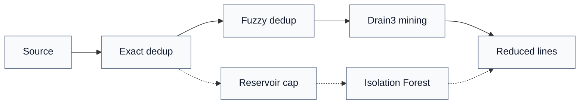
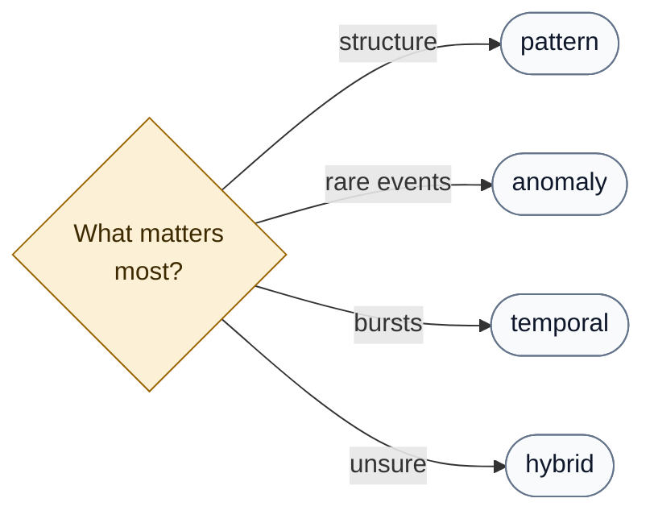

# LogReducer

Reduces gigabytes of logs to a small, representative sample, as a CLI or a Python library.

[](https://pypi.org/project/logreducer/)
[](pyproject.toml)
[](LICENSE)

## What it does

- By default you get a couple of examples of each recurring pattern, and the repeats are dropped. In a DFE deployment dfe-engine's sampler uses it for the smart and anomaly samples of a source's data.
- A `logreducer` command that reduces a file, a SQL or ClickHouse query, or a Kafka topic, straight from the shell.
- Four modes: pattern (Drain3 template mining), anomaly (Isolation Forest), temporal (one candidate per template per time window, ranked, up to `max_patterns`) and hybrid.
- Pattern mode streams through a bounded dedup cache, fuzzy index and template store, so memory does not grow with the line count.
- Lines naming ERROR, FATAL or CRITICAL as a whole word, in any case, come through ahead of the reduced output, one per distinct message once standalone numbers, IPs, UUIDs, hex IDs and ISO timestamps are masked, in every mode and however a file is read. They stop at `max_severe_shapes` distinct messages (`max_patterns` by default), and the stats count the severe lines left out as `severe_dropped`. A SQL or ClickHouse source samples in the database first, so a line the sample drops is never seen.
- A core with no IO dependencies: anything re-iterable that yields `str` lines is a source, and anything with `write(lines)` is a sink. SQL, ClickHouse and Kafka adapters are extras, so you install just the one you use.
- Seeded SQL sampling, PostgreSQL `TABLESAMPLE` and ClickHouse `SAMPLE` for large tables, and `reduce_to_target` to collect about N lines from them.
- Hooks for a host application's config cascade and logging.

## Quick start

Install it as a tool, isolated from your other Python projects (needs the Python version `requires-python` names in `pyproject.toml`):

```bash
uv tool install logreducer        # or: pipx install logreducer
uv tool install "logreducer[clickhouse]"   # with an adapter extra
```

Or add it to a project as a library:

```bash
uv add logreducer                 # or: pip install logreducer
uv add "logreducer[enhanced]"     # fuzzy dedup, faster hashing
uv add "logreducer[sql]"          # SQLSource (SQLAlchemy), bring your own DBAPI driver
uv add "logreducer[clickhouse]"   # ClickHouseSource (clickhouse-connect)
uv add "logreducer[kafka]"        # KafkaSource and KafkaSink (confluent-kafka)
```

Then reduce a file:

```bash
logreducer app.log                                    # reduced lines to stdout
logreducer app.log -o reduced.log -l enhanced -m hybrid
logreducer app.log --format json -o result.json --stats   # run stats on stderr
logreducer huge.log --max-memory 2 --estimate         # cap memory, estimate first
```

```python
from logreducer import LogReducer

reducer = LogReducer(level="standard")

# Reduce a file (writes reduced.log + reduced.meta.json)
reduced = reducer.process_file("app.log", output_file="reduced.log")
print(f"{len(reduced)} representative lines")

# Reduce any re-iterable of lines, no file needed
lines = ["ERROR timeout upstream=payments", "INFO ok", "ERROR timeout upstream=payments"]
reduced = reducer.reduce(lines)
```

`reduce()` returns the reduced lines in memory. Pass `return_metadata=True` for a dict of `{"lines", "stats", "config"}`.

A database query or a Kafka topic is a source in the same way. The CLI dispatches on the `--dsn` scheme, and a library caller constructs the source directly:

```bash
logreducer --dsn postgresql://user@host/db --query "SELECT message FROM logs"       # logreducer[sql] + a driver
logreducer --dsn clickhouse://user@host:8123/db --query "SELECT message FROM logs"  # logreducer[clickhouse]
logreducer --dsn kafka://broker:9092 --topic app-logs --group logreducer            # logreducer[kafka]
```

```python
from logreducer import LogReducer
from logreducer.clickhouse import ClickHouseSource

reducer = LogReducer(level="enhanced", mode="hybrid")
with ClickHouseSource("clickhouse://user@host:8123/db", "SELECT message FROM logs") as source:
    reduced = reducer.reduce(source)
```

The query selects the log line as its first column. Sources are re-iterable (the engine makes several passes), so a database source re-runs its query per pass and a Kafka source re-reads from the earliest offset without committing.

## How it works

Pattern mode streams: lines flow through dedup and template mining as one generator pipeline, so the unique-line set is never materialised. Memory is set by `max_clusters`, `max_patterns` and `dedup_cache_size`, not by the input.

Every line goes through exact dedup first, then down the pattern path or the anomaly path.



*Figure 1. L4 Detail -- Reduction pipeline. Dotted arrows are the anomaly path, which anomaly and hybrid mode take.* Up: [L3 Components -- logreducer](docs/architecture.md#a-reduction-engine-behind-two-protocols).

Pattern mode takes the solid path, anomaly mode the dotted one, and hybrid both. Fuzzy dedup runs at the `enhanced` and `maximum` levels. The reservoir cap is `anomaly_max_rows`, 10,000 rows by default. Severe lines are kept out of both paths and lead the output, one per distinct message.

The anomaly path and temporal mode do not stream. Isolation Forest is batch ML, so `anomaly_max_rows` caps its input. Temporal mode holds every line in memory to group them by time window.

Pattern suits recurring structure, anomaly rare events, temporal bursts in time, and hybrid fits when you're unsure.



*Figure 2. L4 Detail -- Choosing a mode.* Up: [L3 Components -- logreducer](docs/architecture.md#a-reduction-engine-behind-two-protocols).

| Mode | Description | Best for |
|------|-------------|----------|
| `pattern` | Drain3 template mining | Structured and application logs (fastest) |
| `anomaly` | Isolation Forest outlier detection. Below 10 unique lines (after the `anomaly_max_rows` cap) nothing is scored and they all come through, up to `max_patterns` | Security and error logs |
| `temporal` | One candidate per time window and template, most important first, up to `max_patterns` (`temporal_window_minutes`) | Time-series and monitoring logs |
| `hybrid` | Pattern plus anomaly | Maximum coverage |

| Level | Speed | Memory cap | Features |
|-------|-------|-----------|----------|
| `standard` | Fast | 0.5 GB | Deduplication plus pattern extraction |
| `enhanced` | Moderate | 1 GB | plus fuzzy dedup |
| `maximum` | Thorough | 2 GB | plus a wider pattern budget |

Fuzzy dedup needs the `enhanced` extra. Without it the `enhanced` and `maximum` levels skip fuzzy dedup and log a warning.

## Documentation

- [docs/library-guide.md](docs/library-guide.md): sampling large tables, collecting a target number of lines, bounding memory, custom sources and sinks, embedding in a host app, configuration, logging.
- [docs/architecture.md](docs/architecture.md): how the pieces fit.
- [docs/pypi.md](docs/pypi.md): the PyPI page.

How to work in this repo, the toolchain, the test layout (including the log corpora under `tests/testdata/`) and how the integration tests find their services are in [CONTRIBUTING.md](CONTRIBUTING.md). A question that is not a bug goes in an issue.

Open bugs: [this repo](https://github.com/hyperi-io/logreducer/issues?q=is%3Aopen+is%3Aissue+type%3ABug+-label%3Abacklog+-label%3Anext-minor) | [whole DFE suite](https://github.com/search?type=issues&q=is%3Aopen+is%3Aissue+type%3ABug+-label%3Abacklog+-label%3Anext-minor+repo%3Ahyperi-io%2Fdfe-infra+repo%3Ahyperi-io%2Fdfe-docker+repo%3Ahyperi-io%2Fdfe-deploy+repo%3Ahyperi-io%2Fdfe-engine+repo%3Ahyperi-io%2Fdfe-loader+repo%3Ahyperi-io%2Fdfe-receiver+repo%3Ahyperi-io%2Fdfe-fetcher+repo%3Ahyperi-io%2Fdfe-archiver+repo%3Ahyperi-io%2Fdfe-transform-vrl+repo%3Ahyperi-io%2Fdfe-transform-vector+repo%3Ahyperi-io%2Fdfe-transform-elastic+repo%3Ahyperi-io%2Fdfe-ui+repo%3Ahyperi-io%2Fdfe-hyperdx+repo%3Ahyperi-io%2Fscalo-rs+repo%3Ahyperi-io%2Fscalo-py+repo%3Ahyperi-io%2Flogreducer+repo%3Ahyperi-io%2Fdfe-schemas+repo%3Ahyperi-io%2Fvector-vrl+repo%3Ahyperi-io%2Fculvert+repo%3Ahyperi-io%2Fdfe-clickhouse-rs+repo%3Ahyperi-io%2Ffactbook-rs)

## License

[Apache-2.0](LICENSE). Third-party attributions are recorded in [NOTICE](NOTICE). Copyright 2026 HYPERI PTY LIMITED.

Credits: template mining (`src/logreducer/template_mining.py`) is derived from [Drain3](https://github.com/logpai/Drain3), Copyright (c) 2020-2022 International Business Machines and the Drain3 project contributors, MIT licence. Drain3 builds on the Drain parser in LogPAI's [logparser](https://github.com/logpai/logparser). The module header has Drain3's licence text in full.
