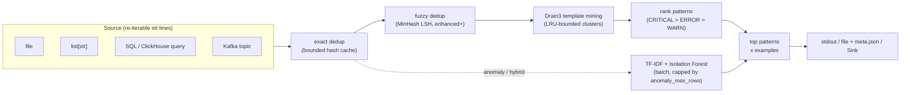

# LogReducer

Reduces gigabytes of logs to a small, representative sample, as a CLI or a Python library.

[](https://pypi.org/project/logreducer/)
[](https://www.python.org/)
[](LICENSE)

## What it does

- By default you get a couple of examples of each recurring pattern, and the repeats are dropped. In a DFE deployment dfe-engine's sampler uses it for the smart and anomaly samples of a source's data.
- A `logreducer` command that reduces a file, a SQL or ClickHouse query, or a Kafka topic, straight from the shell.
- Four modes: pattern (Drain3 template mining), anomaly (Isolation Forest), temporal (one candidate per template per time window, ranked, up to `max_patterns`) and hybrid.
- Pattern mode streams through a bounded dedup cache, fuzzy index and template store, so memory does not grow with the line count or the number of distinct lines.
- Lines naming ERROR, FATAL or CRITICAL as a whole word always come through, one per distinct shape and ahead of the reduced output, in every mode.
- A core with no IO dependencies: anything re-iterable that yields `str` lines is a source, and anything with `write(lines)` is a sink. SQL, ClickHouse and Kafka adapters are extras, so you install only the one you use.

## Installation

As a tool, isolated from your other Python projects (needs Python 3.14+):

```bash
uv tool install logreducer        # or: pipx install logreducer
uv tool install "logreducer[clickhouse]"   # with an adapter extra
```

As a library:

```bash
uv add logreducer                 # or: pip install logreducer
uv add "logreducer[enhanced]"     # fuzzy dedup, faster hashing
uv add "logreducer[sql]"          # SQLSource (SQLAlchemy), bring your own DBAPI driver
uv add "logreducer[clickhouse]"   # ClickHouseSource (clickhouse-connect)
uv add "logreducer[kafka]"        # KafkaSource and KafkaSink (confluent-kafka)
```

## Quick start

```bash
logreducer app.log                                    # reduced lines to stdout
logreducer app.log -o reduced.log -l enhanced -m hybrid
logreducer app.log --format json -o result.json --stats   # run stats on stderr
logreducer huge.log --max-memory 2 --estimate         # cap memory, estimate first
```

```python
from logreducer import LogReducer

reducer = LogReducer(level="standard")

# Reduce a file (writes reduced.log + reduced.meta.json)
reduced = reducer.process_file("app.log", output_file="reduced.log")
print(f"{len(reduced)} representative lines")

# Reduce any re-iterable of lines, no file needed
lines = ["ERROR timeout upstream=payments", "INFO ok", "ERROR timeout upstream=payments"]
reduced = reducer.reduce(lines)
```

`reduce()` returns the reduced lines in memory. Pass `return_metadata=True` for a dict of `{"lines", "stats", "config"}`.

A database or a Kafka topic is a source too. The CLI dispatches on the `--dsn` scheme, and a library caller constructs the source directly:

```bash
logreducer --dsn postgresql://user@host/db --query "SELECT message FROM logs"    # logreducer[sql] + a driver
logreducer --dsn clickhouse://user@host:8123/db --query "SELECT message FROM logs"
logreducer --dsn kafka://broker:9092 --topic app-logs --group logreducer
```

The query selects the log line as its first column. Sources are re-iterable (the engine makes several passes), so a database source re-runs its query per pass and a Kafka source re-reads from the earliest offset without committing.

## How it works

Pattern mode streams: lines flow through dedup and template mining as one generator pipeline, so the unique-line set is never materialised. Memory is set by `max_clusters`, `max_patterns` and `dedup_cache_size`, not by the input.



The anomaly branch is the one part that cannot stream (Isolation Forest is batch ML). Cap its input with `anomaly_max_rows` on very high-cardinality sources.

| Mode | Description | Best for |
|------|-------------|----------|
| `pattern` | Drain3 template mining | Structured and application logs (fastest) |
| `anomaly` | Isolation Forest outlier detection, needs 10 or more unique lines | Security and error logs |
| `temporal` | One candidate per time window and template, most important first, up to `max_patterns` (`temporal_window_minutes`) | Time-series and monitoring logs |
| `hybrid` | Pattern plus anomaly | Maximum coverage |

| Level | Speed | Memory cap | Features |
|-------|-------|-----------|----------|
| `standard` | Fast | 0.5 GB | Deduplication plus pattern extraction |
| `enhanced` | Moderate | 1 GB | plus fuzzy dedup |
| `maximum` | Thorough | 2 GB | plus a wider pattern budget |

## Documentation

- [docs/library-guide.md](docs/library-guide.md): sampling large tables, collecting a target number of lines, bounding memory, your own sources and sinks, embedding in a host app, every config field, logging.
- [docs/architecture.md](docs/architecture.md): how the pieces fit.
- [docs/pypi.md](docs/pypi.md): the PyPI page.

## Help and contributing

How to work in this repo, the toolchain, the test layout (including the real-log corpora under `tests/testdata/`) and how the integration tests find their services are in [CONTRIBUTING.md](CONTRIBUTING.md). A question that is not a bug goes in a new issue.

Open bugs: [this repo](https://github.com/hyperi-io/logreducer/issues?q=is%3Aopen+is%3Aissue+type%3ABug+-label%3Abacklog+-label%3Anext-minor) | [whole DFE suite](https://github.com/search?type=issues&q=is%3Aopen+is%3Aissue+type%3ABug+-label%3Abacklog+-label%3Anext-minor+repo%3Ahyperi-io%2Fdfe-infra+repo%3Ahyperi-io%2Fdfe-docker+repo%3Ahyperi-io%2Fdfe-deploy+repo%3Ahyperi-io%2Fdfe-engine+repo%3Ahyperi-io%2Fdfe-loader+repo%3Ahyperi-io%2Fdfe-receiver+repo%3Ahyperi-io%2Fdfe-fetcher+repo%3Ahyperi-io%2Fdfe-archiver+repo%3Ahyperi-io%2Fdfe-transform-vrl+repo%3Ahyperi-io%2Fdfe-transform-vector+repo%3Ahyperi-io%2Fdfe-transform-elastic+repo%3Ahyperi-io%2Fdfe-ui+repo%3Ahyperi-io%2Fdfe-hyperdx+repo%3Ahyperi-io%2Fscalo-rs+repo%3Ahyperi-io%2Fscalo-py+repo%3Ahyperi-io%2Flogreducer+repo%3Ahyperi-io%2Fdfe-schemas+repo%3Ahyperi-io%2Fvector-vrl+repo%3Ahyperi-io%2Fculvert+repo%3Ahyperi-io%2Fdfe-clickhouse-rs+repo%3Ahyperi-io%2Ffactbook-rs)

## License

[Apache-2.0](LICENSE). Third-party attributions are recorded in [NOTICE](NOTICE). Copyright 2026 HYPERI PTY LIMITED.

Credits: template mining (`src/logreducer/template_mining.py`) is derived from [Drain3](https://github.com/logpai/Drain3), Copyright (c) 2020-2022 International Business Machines and the Drain3 project contributors, MIT licence. Drain3 builds on the Drain parser in LogPAI's [logparser](https://github.com/logpai/logparser). The module header carries Drain3's licence text in full.
