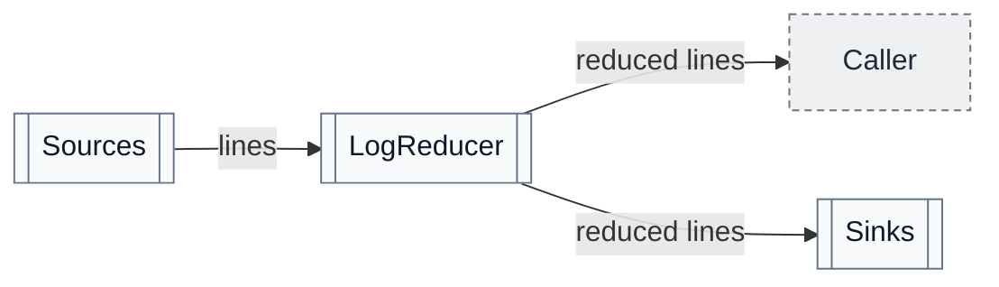

# logreducer architecture

Why the engine is built the way it is. The README covers what it does and how to
drive it -- this page is the reasoning and the invariants a caller cannot infer
from the API.

You have gigabytes of logs and a question. Reading all of it is not an option,
and a random sample is worse than it sounds: random throws away the rare lines,
which are usually the interesting ones, and keeps thousands of copies of the line
that repeats. What a reader actually wants is one of each kind of line, plus the
outliers.

Two constraints make that harder than picking a sample.

- The input does not fit in memory, and neither does the set of UNIQUE lines. A
  10 GB log with 40 million distinct lines will not fit either way, so the engine
  must hold neither.
- Some reduction modes need more than one look at the data, and the data might be
  a database query or a Kafka topic rather than a file.

## A reduction engine behind two protocols

The core does no IO at all. Input is a `Source` -- anything with an `__iter__` that
yields `str` and can be iterated more than once. Output is a `Sink` --
`write(lines) -> int`. Those two structural protocols are the whole IO
surface.

They are protocols rather than base classes on purpose. A `list[str]` is a `Source`
as it stands, and an application's object becomes one without importing
anything from here.

The point of that boundary is ownership. The engine never manages a connection,
so there is nothing for it to leak, nothing for it to time out, and no
credential inside it. The adapters that DO own connections -- SQLAlchemy,
clickhouse-connect, confluent-kafka -- sit behind optional extras, and the core
never imports them.

Sources hand lines to the core on every pass, and the core returns the reduced lines and can write them to a sink.

*Figure 1. L3 Components -- logreducer. The dashed box is the application or CLI that called `reduce()`.* Up: top of logreducer. Down: [L4 Detail -- Reduction pipeline](../README.md#how-it-works), [L4 Detail -- Choosing a mode](../README.md#how-it-works), [L4 Detail -- Sources and sinks](library-guide.md#sources-and-sinks), [L4 Detail -- Collecting a target](library-guide.md#collecting-a-target-number-of-lines).

## Every source is re-iterable

`reduce()` counts lines in one pass to compute the reduction ratio, then re-reads
the source to process it. Hybrid mode reads it a third time. So `__iter__` has to
return a FRESH iterator every call.

A bare generator satisfies the type and breaks the contract, and the failure is
silent in the worst way -- the counting pass drains it and the processing pass
finds nothing, so the result is an empty list rather than an error. That is why
`reduce()` tests `iter(source) is source` and raises `TypeError` up front.

Every adapter follows from the same requirement. `SQLSource` re-runs its query per
pass. `KafkaSource` re-reads from the earliest offset and never commits.
`FileSource` re-opens the file and streams it again. A SQL sample needs a seed
for the same reason: an unseeded one hands pass two a different set of rows
than pass one, and the reducer then compares two populations.

## What streams, and what cannot

Pattern mode streams. Exact dedup, optional fuzzy dedup and Drain3
mining run as one generator pipeline, so the unique-line set is never collected
into a list. Peak memory is the bounded dedup cache, the fuzzy index (the same `dedup_cache_size` window), the Drain3 template store and the results of evicted templates, and none of them grows with the number of unique lines the source has. The one exception is the severe-line store, which keeps one line per distinct ERROR, FATAL or CRITICAL message in every mode, up to `max_severe_shapes` (`max_patterns` by default).

An evicted template's result is kept as long as it can still make the `max_patterns` cut. Its count stops changing once the dedup cache has dropped the lines that fed it, so from then on it competes for one of `max_patterns` places, and a result that loses one can never win it back. That keeps the output identical to ranking every template ever seen.

In a 2026-11-01 test run the fuzzy index used about 1.8 KB per entry, so the preset windows hold about 180 MB at enhanced (100K lines) and 360 MB at maximum (200K), inside their 1 GB and 2 GB budgets.

Drain3 compares each line with every template stored at the leaf it reaches, so
time grows with the square of the template count when lines share no tokens.
`max_leaf_clusters` (128 by default) compares a line with the templates at its leaf
that last took a line, and `max_clusters` (10,000) bounds the store. A 2026-11-27
test run on the 40,000-line HealthApp corpus took 1.8 s with the cap and 23 s without,
for 2% more templates. One-token lines, compact JSON among them, are looked up by token.

Temporal mode returns one example per time window and template, ranked by severity and count, and does not stream. It reads every line and a parsed entry per line
into memory before grouping, so it ignores `max_memory_gb`. A 2026-10-31 test run on an 80 MB
file peaked at 832 MB, against 156 MB for pattern mode.

Anomaly mode cannot stream. Isolation Forest over a TF-IDF matrix is batch ML and
needs its rows at once, so `anomaly_max_rows` reservoir-samples them with a fixed
seed, 10,000 by default, trading anomaly recall for a bounded matrix. Terms are
hashed into columns rather than held in a vocabulary, so memory follows the rows,
not the distinct terms.

## Collecting a target instead of reducing everything

`reduce_to_target` is a different loop for a different question: about N
representative lines, rather than all of the input reduced. It pulls fresh random
batches, reduces each, and accumulates distinct representatives until one of five
stop conditions fires -- target, exhausted, max_fetches, plateau, or memory.
Batch size is resized from the observed average row bytes, so peak memory stays
around one batch plus the accumulator.

The stop reason is reported rather than hidden, because "plateau" and "target"
mean very different things about the answer you are holding.

## Determinism

Every sample the engine draws itself is seeded. The anomaly reservoir, the
normal-context sample and a sampled `FileSource` use a fixed seed. A SQL sample
is reproducible when you pass `sample_seed`: an unseeded one is accepted and may
differ between passes. ClickHouse `SAMPLE` is deterministic with no seed.
`reduce_to_target` is the exception:
each round wants fresh rows, so a database draws its batch unseeded, and the
client-side reservoir for any other source is seeded when you pass `seed`, and unseeded otherwise.

That is not a security property, and there is no security requirement in picking
log lines. It is a correctness property the multi-pass design depends on: pass
two has to see what pass one saw.

The same property is why SQLite raises `SamplingNotSupported` for a seeded sample instead
of quietly giving an unseeded one. SQLite has no seedable RNG, so it cannot keep
the promise, and pretending otherwise would produce a result that looks
reproducible and is not.

## Embedding in a host application

Three hooks, none of which needs the library to know anything about the host.

| Hook | How |
|---|---|
| Config | Build a `BigDialConfig` from the host's cascade and inject it, or call `BigDialConfig.from_env(prefix, fallback)` where the prefixed name beats the bare one. Keyword arguments still win on top |
| Logging | Off by default. With `enable_logging=True` and no `log_file` the reducer registers no handler, so records flow through the host's handlers formatted by the host's standard. Building a reducer applies its config's logging, so `setup_logging(enable=True, own_sinks=False)` after it hands the level to the host too |
| IO | The `Source` and `Sink` protocols above |

## Invariants

1. `__iter__` returns a fresh iterator, checked at the entry point rather than documented and hoped for.
2. The core imports no IO library. An adapter's dependency is an extra, and the core never imports the adapter modules.
3. Analysis state is per run. `_reset_components()` rebuilds the dedup seen-set, both Drain3 miners and the fuzzy LSH, so one `LogReducer` is reusable across calls and hybrid's two passes cannot poison each other. Without it every line reads as seen and the result is empty.
4. An unknown config keyword raises. A silently dropped override is tuning that quietly does nothing, which is worse than a failure.
5. The row-to-line convention is shared. The database adapters take the FIRST column, skip NULLs and skip blank lines, matching `FileSource`, so the same data reduces identically whichever source carried it.
6. Samples the engine draws are seeded, and a SQL sample is reproducible when you pass `sample_seed`. See above.
7. Config enums serialise as their `.value`, so metadata survives `json.dumps` and no `OutputFormat.LINE`-style repr leaks into output.
8. A memory ceiling above 70% of available RAM is clamped with a warning rather than accepted, whether it comes from the config or a `LogReducer` argument.

Three figures are approximate. `input_lines` and the reduction ratio come from the counting pass over the
source. A size-sampled `FileSource` yields its SAMPLED line count, so on a very
large file both figures describe the sample rather than the file. Say which when
quoting them.

`estimate_processing` is a size-based estimate and nothing more -- it reads the
file size and the chosen read strategy, and does not look at the content.
