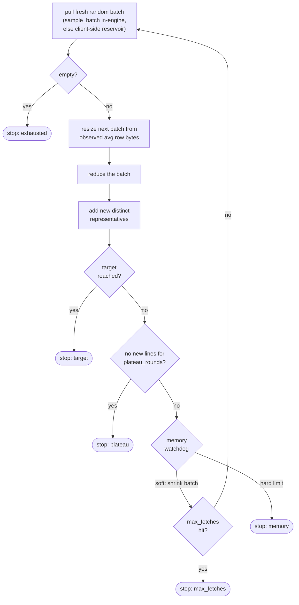
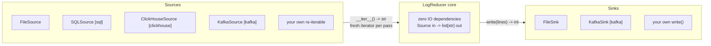

# Using logreducer as a library

The README covers the install, the CLI and the first `LogReducer` call. This page is the rest of the library surface: sampling, collecting a target, memory, sources and sinks, embedding, configuration and logging.

## Sampling large sources

For a table too large to scan in full, sample a fraction of rows. SQL sampling is deterministic when you pass a seed (so the reducer's multi-pass modes see a stable input). ClickHouse uses its native `SAMPLE` clause.

```python
from logreducer.sql import SQLSource

# Wrap any query in a seeded random predicate (PostgreSQL/MySQL)
source = SQLSource("postgresql://user@host/db", "SELECT msg FROM logs", sample=0.01, sample_seed=42)

# Or sample a TABLE with the engine's native sampler - PostgreSQL
# TABLESAMPLE SYSTEM is page-level and genuinely sub-linear:
source = SQLSource.from_table("postgresql://user@host/db", "logs", "msg", sample=0.01, sample_seed=42)
```

```bash
logreducer --dsn postgresql://user@host/db --query "SELECT msg FROM logs" --sample 0.01 --sample-seed 42
```

Notes: SQLite has no seedable RNG, so a seeded sample raises `SamplingNotSupported` (unseeded, best-effort sampling still works). ClickHouse `SAMPLE` needs the table to declare a `SAMPLE BY` key. For an arbitrary complex query, put the sampling clause in your own SQL instead.

## Collecting a target number of lines

When you want *about N* representative lines rather than "reduce everything", `reduce_to_target` pulls fresh random batches and reduces each, accumulating distinct representatives until a stop condition fires. Peak memory is bounded to roughly one batch plus the accumulator.



```python
from logreducer import LogReducer, reduce_to_target
from logreducer.sql import SQLSource

reducer = LogReducer(level="enhanced", mode="hybrid")
source = SQLSource("postgresql://user@host/db", "SELECT msg FROM logs")
outcome = reduce_to_target(source, reducer, target_rows=5000, max_batch_memory_gb=1.0)
print(outcome["stats"]["stop_reason"])   # target / exhausted / max_fetches / plateau / memory
lines = outcome["lines"]
```

```bash
logreducer --dsn postgresql://user@host/db --query "SELECT msg FROM logs" \
    --target-rows 5000 --max-fetches 50 --max-batch-memory 1.0
```

## Bounding memory

Pattern mode streams, and its memory is fixed by the knobs below, not by lines or distinct templates. Temporal mode holds the whole source in memory, and anomaly mode holds its unique lines. The knobs:

- `max_memory_gb` - the overall cap (also sizes file read strategy and the watchdog). Presets: 0.5 / 1 / 2 GB by level. Values above 70% of available RAM are clamped with a warning.
- `dedup_cache_size` - the lines exact dedup remembers, and at enhanced and maximum the lines the fuzzy index holds. Both drop the oldest first, so a repeat or near-repeat older than the window comes through again.
- `max_clusters` - LRU-bound the Drain3 template store (10,000 by default, `None` for unbounded, which also keeps every evicted template's result). A lower value bounds the template store and cuts the work per line on high-cardinality sources.
- `anomaly_max_rows` - reservoir-cap the rows fed to anomaly detection (off by default, and it trades anomaly recall for a bounded matrix).

```python
reducer = LogReducer(level="enhanced", mode="hybrid", max_clusters=50_000, anomaly_max_rows=200_000)
```

## Sources and sinks

The engine is built around two tiny structural protocols - that is the whole integration surface:



An application can hand the reducer its own IO - anything that yields `str` and can be iterated more than once is a `Source`:

```python
class MySource:
    def __iter__(self):
        yield from open_my_stream()  # must return a FRESH iterator each call

reducer.reduce(MySource())
```

Output works the same way through a `Sink` (`write(lines) -> int`):

```python
from logreducer import LogReducer, FileSink

reducer.reduce(source, sink=FileSink("reduced.jsonl", output_format="jsonl"))
```

## Embedding in a host application

A host app that owns its own config cascade and logging standard drives logreducer with three hooks - no logreducer-side knowledge of the host required:

```python
import logreducer

# 1. Config: build it from YOUR cascade and inject it (kwargs still win on top)...
cfg = logreducer.BigDialConfig(max_memory_gb=0.5, max_patterns=800)
reducer = logreducer.LogReducer(mode="hybrid", config=cfg)

# ...or let logreducer read your env cascade directly: prefixed beats bare.
cfg = logreducer.BigDialConfig.from_env("MYAPP", "LOGREDUCER")   # MYAPP_MAX_MEMORY_GB wins

# 2. Logging: your app owns the stdlib logging handlers; logreducer attaches
#    nothing and its records flow through YOUR handlers, at YOUR level,
#    formatted by YOUR standard.
logreducer.setup_logging(enable=True, own_sinks=False)
```

## Configuration

Override any config field as a keyword argument (unknown names raise - typos never silently no-op):

```python
reducer = LogReducer(
    level="enhanced",
    mode="hybrid",
    max_memory_gb=1.0,          # memory ceiling (clamped to 70% of available RAM)
    dedup_cache_size=100000,    # bounded dedup cache and fuzzy index
    drain_similarity=0.4,       # pattern similarity threshold
    fuzzy_threshold=0.8,        # fuzzy-dedup threshold (enhanced/maximum)
    anomaly_contamination=0.1,  # expected anomaly fraction
    temporal_window_minutes=60, # grouping window for temporal mode
    max_patterns=2000,          # cap on extracted patterns
    min_pattern_occurrences=2,  # patterns seen fewer times are dropped, except CRITICAL/FATAL/ERROR ones
)
```

## Logging

Logging is off by default. Enable it and pick a format via env vars:

```bash
LOG_LEVEL=DEBUG LOG_FORMAT=json logreducer app.log --log
```

Logging is the standard library `logging` module, under the `logreducer` logger. `LOG_FORMAT=json` emits one JSON object per line for log aggregators (keys `timestamp`, `level`, `target`, `function`, `line_number`, `message`, `fields`). The default is human-readable (coloured in a terminal, plain in CI/containers). Embedding? See `own_sinks=False` above.
